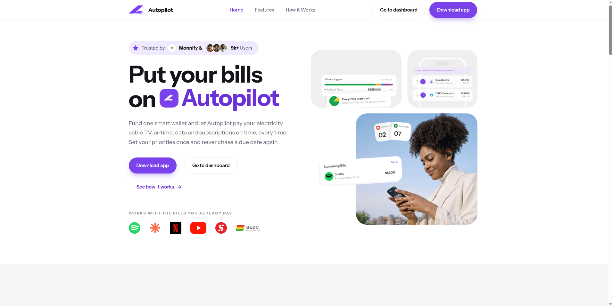
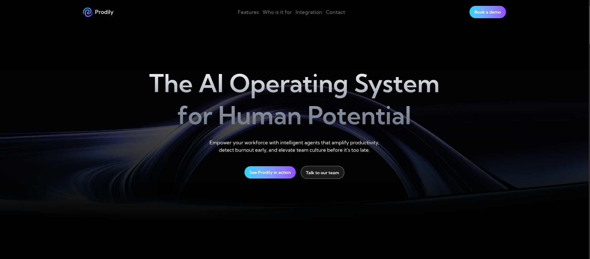
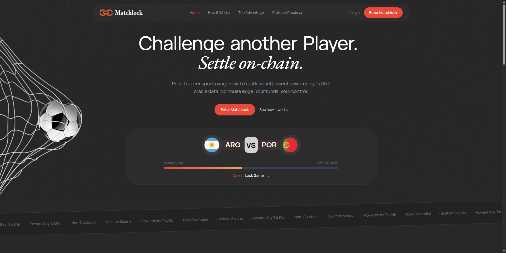

  

  <h1>Olubayo Wisdom</h1>

  

    <strong>Software Engineer &middot; Product Designer &middot; Founder at <a href="https://reslve.org">Reslve</a></strong>
  

  

    I turn ambitious product ideas into fast, scalable, AI-enhanced applications 
    built for real users and measurable business impact.
  

  

    
    
    
    
    
  

---

## I build products that hold up in the real world

My work spans frontend architecture, backend systems, data-heavy dashboards,
payments, subscriptions, healthcare workflows, energy analytics, and on-chain
programs. I am most useful where product thinking and engineering depth need to
meet.

  <table>
    <tr>
      <td align="center"><strong>10+</strong> client products shipped</td>
      <td align="center"><strong>1M+</strong> data points synced daily</td>
      <td align="center"><strong>126</strong> routes in one analytics platform</td>
      <td align="center"><strong>200ms</strong> optimized analytics latency</td>
    </tr>
  </table>

### What I focus on

- Designing and shipping complete web products, from interface to infrastructure
- Building scalable APIs, data pipelines, payments, and subscription systems
- Turning complex operational workflows into clear, efficient product experiences
- Improving performance, reliability, accessibility, and delivery quality

## Featured work

<table>
  <tr>
    <td width="50%" valign="top">
      
      <h3>Autopilot</h3>
      

        A Nigerian bill-payment product that automates electricity, cable,
        airtime, data, and subscription payments from one smart Monnify wallet.
      

      
<strong>Fintech &middot; Mobile &middot; Web</strong>

      <a href="https://autopilot-monnify.netlify.app/">View live product &rarr;</a>
    </td>
    <td width="50%" valign="top">
      
      <h3>Prodily</h3>
      

        A multi-role productivity and culture platform for onboarding, tasks,
        meetings, wellbeing, time tracking, and workforce insights.
      

      
<strong>React &middot; TypeScript &middot; Product Analytics</strong>

      <a href="https://www.prodily.tech/">View live product &rarr;</a>
    </td>
  </tr>
  <tr>
    <td width="50%" valign="top">
      
      <h3>Platline</h3>
      

        A sports analytics and subscription platform with 126 routes across 25
        modules, daily MLB data synchronization, and a full React dashboard.
      

      
<strong>NestJS &middot; React &middot; Redis &middot; Stripe</strong>

      <a href="https://www.platlinesports.com">View live product &rarr;</a>
    </td>
    <td width="50%" valign="top">
      
      <h3>Matchlock</h3>
      

        Peer-to-peer sports wagering on Solana with on-chain escrow, oracle
        settlement, and a Go keeper/API.
      

      
<strong>Anchor &middot; Rust &middot; Go &middot; React &middot; Solana</strong>

      <a href="https://matchlock-u1ww.onrender.com/">View live product &rarr;</a>
    </td>
  </tr>
  <tr>
    <td width="50%" valign="top">
      
      <h3>Wattlens</h3>
      

        A cloud energy-data platform that turns raw CSV files into clean
        insights, visualizations, natural-language answers, and reports.
      

      
<strong>Energy Analytics &middot; SaaS &middot; AI</strong>

      <a href="https://www.wattlens.com">View live product &rarr;</a>
    </td>
    <td width="50%" valign="top">
      
      <h3>Top Token Trader</h3>
      

        An interactive crypto analytics tool for exploring ERC-20 trader
        activity through a live D3.js bubble map and Telegram Web App.
      

      
<strong>D3.js &middot; React &middot; Alchemy API</strong>

      <a href="https://bubblemapsviz.onrender.com/">View live product &rarr;</a>
    </td>
  </tr>
</table>

  <a href="https://wisdomolubayo.bio/#work"><strong>Explore all projects on my portfolio &rarr;</strong></a>

## Technology

**Frontend**

**Backend**

**Data & Infrastructure**

## GitHub activity

  <picture>
    <source
      media="(prefers-color-scheme: dark)"
      srcset="https://github-stats-extended.vercel.app/api?username=wizzyszn&amp;show_icons=true&amp;hide_border=true&amp;bg_color=00000000&amp;title_color=ff003d&amp;icon_color=ff003d&amp;text_color=ededed"
    />
    <source
      media="(prefers-color-scheme: light)"
      srcset="https://github-stats-extended.vercel.app/api?username=wizzyszn&amp;show_icons=true&amp;hide_border=true&amp;bg_color=00000000&amp;title_color=d80035&amp;icon_color=d80035&amp;text_color=222222"
    />
    
  </picture>

---

  <h3>Let&rsquo;s build something useful.</h3>
  

    I am open to software engineering roles, contract builds, and ambitious
    product teams.
  

  

    <a href="mailto:wisdomolubayoadedoyin@yahoo.com"><strong>Email me</strong></a>
    &nbsp;&middot;&nbsp;
    <a href="https://cal.com/wizzyszn/30min"><strong>Book a call</strong></a>
    &nbsp;&middot;&nbsp;
    <a href="https://wisdomolubayo.bio/"><strong>Visit my portfolio</strong></a>
  

